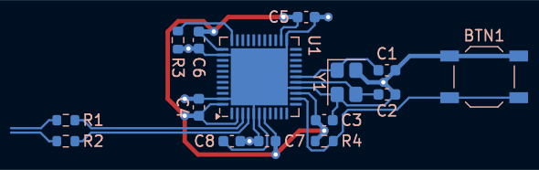
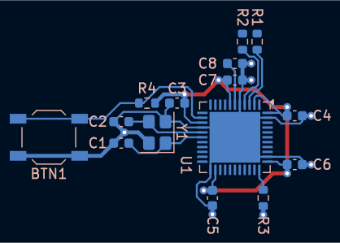
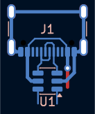
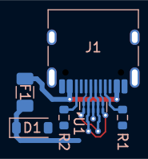
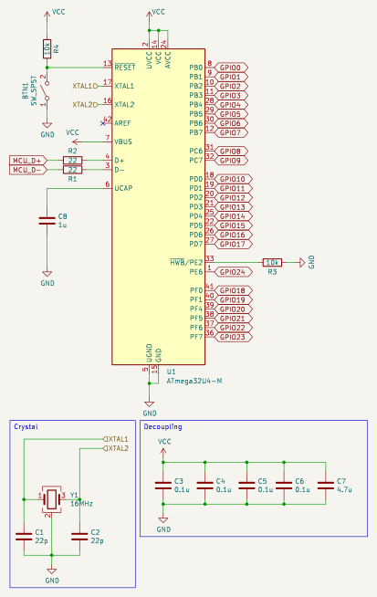
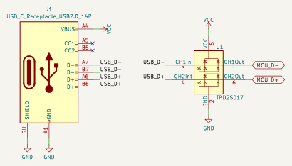
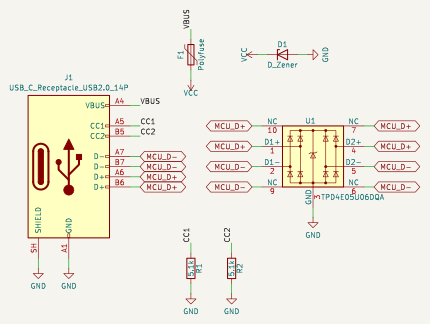

# Presets

Presets are layout independent parts of a keyboard (microcontroller circuit,
USB connector, ...) which `kbplacer` adds to the generated project next to the
key matrix. They are plain [KiCad design blocks](https://docs.kicad.org/10.0/en/eeschema/eeschema_design_blocks.html),
so they can be used and edited in KiCad without `kbplacer`.
Add `design_blocks/kbplacer.kicad_blocks` to KiCad's design block library table
to place them by hand.

Use a preset with `--preset` option, it may be repeated to combine presets
(for example microcontroller with USB connector):

```shell
python -m kbplacer --create-pcb-file --create-sch-file --pcb-file keyboard.kicad_pcb \
  --layout <via-annotated-layout.json> --switch-footprint ... --diode-footprint ... \
  --preset "design_blocks/kbplacer.kicad_blocks:mcu_atmega32u4_v1 120 30 90 BACK" \
  --preset "design_blocks/kbplacer.kicad_blocks:usb_udb_clone 120 10 0 BACK"
```

Microcontroller presets connect to USB presets with `MCU_D+`/`MCU_D-` global
labels, power nets (`VCC`, `GND`) are shared by all presets and the key matrix.

The preset schematic becomes a sheet of the generated project and its PCB layout
is placed at the given `X Y [ROTATION]` (mm, degrees) or below the keyboard when
position is omitted. `FRONT` or `BACK` puts its components on that side of the
board (the layout is flipped around the block origin when needed), so any preset
works on either side. Previews below show the components side. References are
renumbered so they do not collide with the key matrix or other presets. See [presets](../README.md#presets) for details.

To try it, run `just presets` (see [`.justfile`](../.justfile)).

## Available presets

<!-- presets:begin -->
<!-- generated with tools/block2image.py, do not edit by hand -->

| Preset | Description | Key matrix | PCB |
| --- | --- | --- | --- |
| [mcu_atmega32u4](#mcu_atmega32u4)<br>variants: [mcu_atmega32u4_v1](#mcu_atmega32u4_v1), [mcu_atmega32u4_v2](#mcu_atmega32u4_v2) | ATmega32U4 microcontroller with 16 MHz crystal, reset button, USB data line resistors and decoupling capacitors. | 25 pins, up to 12×13 | <a href="#mcu_atmega32u4_v1"></a> <a href="#mcu_atmega32u4_v2"></a> |
| [usb_minimal](#usb_minimal) | USB-C receptacle (USB 2.0) with TPD2S017 ESD protection, connector VBUS powers VCC directly. Minimal version without CC pull-down resistors, only USB-A to USB-C cables power the board. | - | <a href="#usb_minimal"></a> |
| [usb_udb_clone](#usb_udb_clone) | USB-C receptacle (USB 2.0) with TPD4E05U06DQA ESD protection, CC pull-down resistors, polyfuse and zener diode on VCC. Clone of Unified Daughterboard (UDB-C) circuit, with two-layer routing. | - | <a href="#usb_udb_clone"></a> |

### mcu_atmega32u4

ATmega32U4 microcontroller with 16 MHz crystal, reset button, USB data line resistors and decoupling capacitors.

Keywords: mcu atmega32u4 usb

Variants `mcu_atmega32u4_v1`, `mcu_atmega32u4_v2` share the schematic and differ in PCB layout.

- **Key matrix:** 25 `GPIO` pins, up to 12×13 matrix (156 keys)
- **Interface labels:** `MCU_D+`, `MCU_D-`
- **Power:** `GND`, `VCC`



<details>
<summary>Components (15)</summary>

| References | Value | Footprint |
| --- | --- | --- |
| BTN1 | SW_SPST | `Button_Switch_SMD:SW_SPST_TL3342` |
| C1-C2 | 22p | `Capacitor_SMD:C_0603_1608Metric` |
| C3-C6 | 0.1u | `Capacitor_SMD:C_0603_1608Metric` |
| C7 | 4.7u | `Capacitor_SMD:C_0603_1608Metric` |
| C8 | 1u | `Capacitor_SMD:C_0603_1608Metric` |
| R1-R2 | 22 | `Resistor_SMD:R_0603_1608Metric` |
| R3-R4 | 10k | `Resistor_SMD:R_0603_1608Metric` |
| U1 | ATmega32U4-M | `Package_DFN_QFN:QFN-44-1EP_7x7mm_P0.5mm_EP5.2x5.2mm` |
| Y1 | 16MHz | `Crystal:Crystal_SMD_3225-4Pin_3.2x2.5mm` |

</details>

<details>
<summary>Matrix pins (<code>--matrix-pin-order</code> labels)</summary>

| Label | Pin |
| --- | --- |
| `GPIO0` | U1 pin 8 (PB0) |
| `GPIO1` | U1 pin 9 (PB1) |
| `GPIO2` | U1 pin 10 (PB2) |
| `GPIO3` | U1 pin 11 (PB3) |
| `GPIO4` | U1 pin 28 (PB4) |
| `GPIO5` | U1 pin 29 (PB5) |
| `GPIO6` | U1 pin 30 (PB6) |
| `GPIO7` | U1 pin 12 (PB7) |
| `GPIO8` | U1 pin 31 (PC6) |
| `GPIO9` | U1 pin 32 (PC7) |
| `GPIO10` | U1 pin 18 (PD0) |
| `GPIO11` | U1 pin 19 (PD1) |
| `GPIO12` | U1 pin 20 (PD2) |
| `GPIO13` | U1 pin 21 (PD3) |
| `GPIO14` | U1 pin 25 (PD4) |
| `GPIO15` | U1 pin 22 (PD5) |
| `GPIO16` | U1 pin 26 (PD6) |
| `GPIO17` | U1 pin 27 (PD7) |
| `GPIO18` | U1 pin 41 (PF0) |
| `GPIO19` | U1 pin 40 (PF1) |
| `GPIO20` | U1 pin 39 (PF4) |
| `GPIO21` | U1 pin 38 (PF5) |
| `GPIO22` | U1 pin 37 (PF6) |
| `GPIO23` | U1 pin 36 (PF7) |
| `GPIO24` | U1 pin 1 (PE6) |

</details>

#### mcu_atmega32u4_v1

Elongated layout with USB data lines leaving to the side.

```shell
--preset design_blocks/kbplacer.kicad_blocks:mcu_atmega32u4_v1
```

- **PCB:** 47.1 × 13.5 mm


#### mcu_atmega32u4_v2

Compact layout with USB data lines leaving to the top.

```shell
--preset design_blocks/kbplacer.kicad_blocks:mcu_atmega32u4_v2
```

- **PCB:** 32.8 × 22.8 mm


### usb_minimal

USB-C receptacle (USB 2.0) with TPD2S017 ESD protection, connector VBUS powers VCC directly. Minimal version without CC pull-down resistors, only USB-A to USB-C cables power the board.

Keywords: usb usb-c connector esd

```shell
--preset design_blocks/kbplacer.kicad_blocks:usb_minimal
```

- **PCB:** 9.3 × 11.5 mm


- **Key matrix:** none (no `GPIO<n>` labels)
- **Interface labels:** `MCU_D+`, `MCU_D-`
- **Power:** `GND`, `VCC`



<details>
<summary>Components (2)</summary>

| References | Value | Footprint |
| --- | --- | --- |
| J1 | USB_C_Receptacle_USB2.0_14P | `Connector_USB:USB_C_Receptacle_GCT_USB4105-xx-A_16P_TopMnt_Horizontal` |
| U1 | TPD2S017 | `Package_TO_SOT_SMD:SOT-23-6` |

</details>

### usb_udb_clone

USB-C receptacle (USB 2.0) with TPD4E05U06DQA ESD protection, CC pull-down resistors, polyfuse and zener diode on VCC. Clone of Unified Daughterboard (UDB-C) circuit, with two-layer routing.

Keywords: usb usb-c connector esd udb

```shell
--preset design_blocks/kbplacer.kicad_blocks:usb_udb_clone
```

- **PCB:** 13.4 × 14.5 mm


- **Key matrix:** none (no `GPIO<n>` labels)
- **Interface labels:** `MCU_D+`, `MCU_D-`
- **Power:** `GND`, `VCC`



<details>
<summary>Components (6)</summary>

| References | Value | Footprint |
| --- | --- | --- |
| D1 | D_Zener | `Diode_SMD:D_SOD-123` |
| F1 | Polyfuse | `Fuse:Fuse_1206_3216Metric` |
| J1 | USB_C_Receptacle_USB2.0_14P | `Connector_USB:USB_C_Receptacle_HRO_TYPE-C-31-M-12` |
| R1-R2 | 5.1k | `Resistor_SMD:R_0603_1608Metric` |
| U1 | TPD4E05U06DQA | `Package_SON:USON-10_2.5x1.0mm_P0.5mm` |

</details>

<!-- presets:end -->

## Creating presets

1. Draw the circuit in KiCad project (like [`mcu.kicad_sch`](mcu.kicad_sch)
   or [`usb.kicad_sch`](usb.kicad_sch), which holds both USB circuits, each
   PCB layout in a group named like its block), route its PCB and save both
   as one design block to `kbplacer.kicad_blocks` (_Save Selection as Design
   Block_ in schematic and PCB editors, under the same block name).
   References in the project may differ from the block, `kbplacer` renumbers
   them anyway.
2. Mark pins which can drive the key matrix with global labels `GPIO0`,
   `GPIO1`, ... `kbplacer` connects them to rows and then columns of the
   matrix in label number order (unless `--matrix-pin-order` used),
   so number them in preferred order. Only one preset may have `GPIO` labels.
3. Connect presets with each other using other global labels, like
   `MCU_D+`/`MCU_D-` of the microcontroller and USB connector.
4. Annotate all symbols, the block PCB must use the same references.
5. Fill the block description (shown in KiCad's design block chooser and below).
   Alternative PCB layouts of the same circuit are variants: name them
   `<name>_v1`, `<name>_v2`, ... and keep their schematics equal, they are
   presented together with the shared circuit described once. Start variant
   descriptions with the same sentences describing the circuit, the rest
   describes the layout.
6. Regenerate images and the list above:

   ```shell
   just tools-block2image
   # or directly, with KiCad 10.0+ installed:
   python tools/block2image.py --in design_blocks/kbplacer.kicad_blocks \
     --out design_blocks/images --readme design_blocks/README.md
   ```
