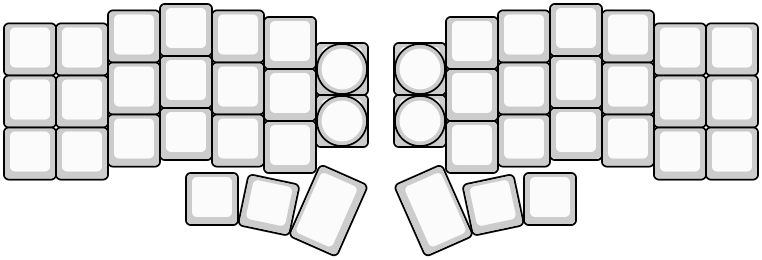
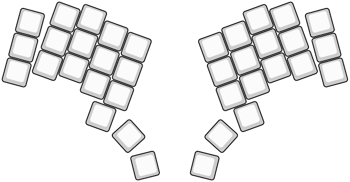

# Tools

- `layout2image.py` - generate KLE style SVG image from keyboard layout
- `layout2openscad.py` - generate plate for [openscad](https://openscad.org/) (:warning: experimental)
- `pcb2layout.py` - reverse-engineer KLE layout from existing `.kicad_pcb` file (:warning: experimental)
- `profiling/kle-ng-api-task.sh` - reproduce a complete kle-ng-api task (schematic + pcb) for memory profiling

## Memory profiling (memray)

`profiling/kle-ng-api-task.sh` runs one `kbplacer` process with both
`--create-sch-file` and `--create-pcb-file`, mirroring the arguments
`kle-ng-api` builds for a single generation request. It is meant to estimate the
peak memory of a complete task (useful for sizing worker memory limits, since
KiCad's `pcbnew` SWIG bindings have historically leaked). Run it under
[memray](https://github.com/bloomberg/memray) inside docker with:

```shell
just profile-memray                  # KiCad 9.0.9, full routing (worst case)
just profile-memray 10.0.3-noble     # different KiCad version
just profile-memray 9.0.9-noble none # disable routing
```

Outputs land in `./output_memray/`: `profile.bin`, `flamegraph.html` (peak
usage) and `flamegraph-leaks.html` (memory still allocated at exit). The recipe
also prints `memray summary`/`stats`, whose peak/high-water-mark is the number
to compare against the container memory limit.

## Reverse-engineering layout from PCB (pcb2layout)

`pcb2layout.py` recovers KLE layout from existing `.kicad_pcb` file
(requires KiCad's `pcbnew` python module):

```shell
hatch run tools-pcbnew:pcb2layout --in keyboard.kicad_pcb --out layout.json --matrix-labels --verify
```

- switches, key sizes and key spacing are guessed from footprint names, stabilizers
  and switch positions; when guesses are wrong, guide them with options like
  `--switch-pattern "SW{}"` or `--key-distance "18 17"`
- `--matrix-labels` adds via-style `row,column` labels based on the matrix nets
- footprints accepting either switch or encoder (like Corne's) become switches with
  overlapping encoder alternatives, see `--hybrid-encoders`; with `--matrix-labels`
  alternative layout keys are moved below the layout (VIA style) unless
  `--alternatives-in-place` is used
- `--verify` creates PCB out of the recovered layout with `kbplacer` and compares
  switch positions with the input, printing a score (100% = exact match)

See `hatch run tools-pcbnew:pcb2layout --help` for all options.

To try it on a public PCB, download it, recover its layout, render it to SVG and
print [kle-ng](https://editor.keyboard-tools.xyz) link in one step
(outputs go to `./output_pcb2layout/`):

```shell
just tools-pcb2layout https://github.com/foostan/crkbd/blob/main/pcbs/corne-cherry/hotswap/corne-cherry.kicad_pcb
```



## How to run

The `kbplacer` project uses `pyprojet.toml` with [`hatch`](https://hatch.pypa.io) project manager.
It defines `tools` environment with required dependencies and scripts.
To execute, run:

```shell
$ hatch run tools:layout2image {args...}
$ hatch run tools:layout2openscad {args...}
$ hatch run tools-pcbnew:pcb2layout {args...}
```

Alternatively, install required dependencies and run as regular python script:

```shell
python tools/layout2image.py {args...}
python tools/layout2openscad.py {args...}
python tools/pcb2layout.py {args...}
```

## Examples

To generate layout image based on layout file:

```shell
hatch run tools:layout2image --in tests/data/ergogen-layouts/absolem-simple-points.yaml \
  --out absolem.svg
```



To convert `ergogen` layouts to KLE see [layout and format conversion script](../README.md#layout-format-conversion-script)

> [!WARNING]
> Tools are not yet part of `kbplacer` package and are tested mostly by-hand.
> To execute limited tests we have run `hatch run tools:test`
> (`hatch run tools-pcbnew:test` to include `pcb2layout` tests, requires KiCad's `pcbnew` module).
